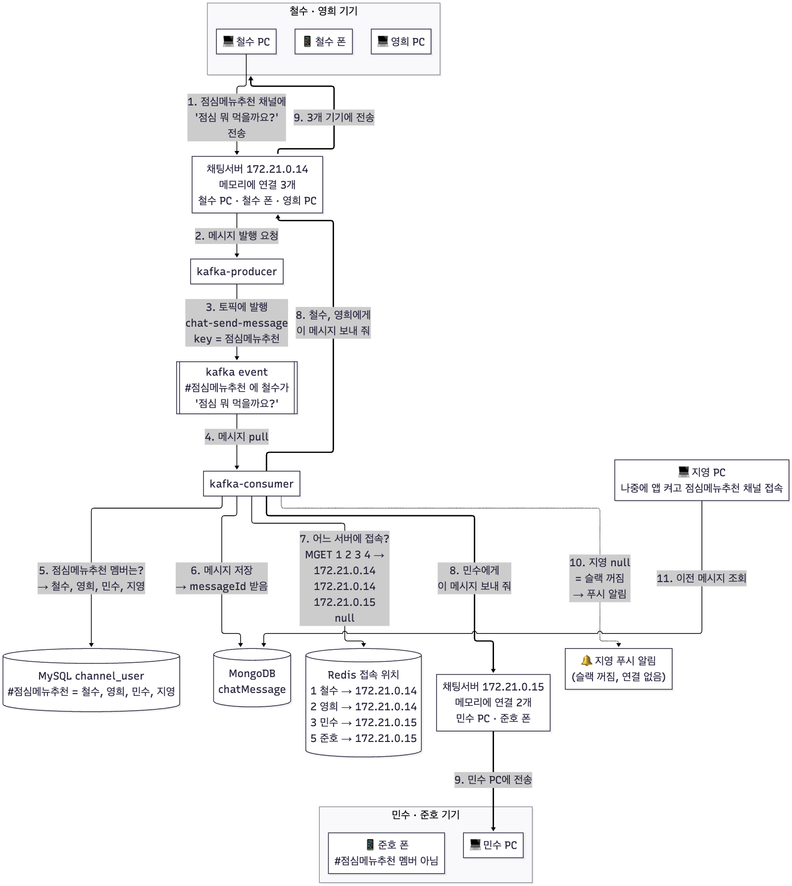

# Distributed Chat System

<br>

## 사용법

```
1. cp .env.example .env

2. docker compose up -d --build

3. visit localhost:8080
```

<br>

## 모듈 계층

```
distributed-chat-system
  ├── common    # 1 depth - 공통 기능 모듈
  ├── infra     # 2 depth - 인프라 관련 모듈
  └             # 3 depth - 프로젝트 모듈
```

- distributed-chat-system
    - 📂 common
        - 📁 distributed-chat-system-common
    - 📂 infra
        - 📁 distributed-chat-system-api-gateway
        - 📁 distributed-chat-system-mongodb
        - 📁 distributed-chat-system-mysql
        - 📁 distributed-chat-system-redis
        - 📁 distributed-chat-system-service-discovery
    - 📁 distributed-chat-system-chatting
    - 📁 distributed-chat-system-client-api
    - 📁 distributed-chat-system-kafka-consumer
    - 📁 distributed-chat-system-kafka-producer
    - 📁 distributed-chat-system-notification

<br>

## 아키텍처 설계


<br>

## 채팅 메시지 흐름

> **모든 실시간 기능은 WebSocket을 통해 동작** ([ref : WebSocket 프로토콜](https://rotomoo.tistory.com/100))
>
> **실시간 접속 데이터 및 메시지 전송을 채팅 서버 메모리로 관리**
> 
> - DB 저장 : 초당 약 230건 (N명에게 보내도 1번)
> - 메시지 전송 : 초당 230 × N건, 채팅 서버 메모리로 처리



# 설계과정

## 기능 요구사항

- DAU(Daily Active User) 1,000,000명 지원 시스템
- 팀 기능
- 실시간 DM(Direct Message), 채널 채팅 기능
- 실시간 팀 사용자 접속상태 표시 기능
- 채팅 메시지 첨부파일(이미지) 지원 기능
- 채팅 메시지 이모티콘 반응 기능
- 채팅 메시지 댓글 기능
- 멘션 기능
- 채팅 메시지 종단 간 암호화 필요
- 모든 채팅 이력 10년 보관
- 다양한 단말 동시 접속 지원
- 푸시 알림 기능

## 개략적 규모 추정

**저장소 요구량**

- DAU (Daily Active Users): 1,000,000명
- 1인당 일일 평균 메시지 전송 수: 20건 → 하루 20,000,000건 (평균 초당 약 230건)
- 최대 텍스트 메시지 길이: 4,000자 (한글 UTF-8 약 12KB)
- 평균 메시지 문서 크기: 1KB (본문 + ID / 시각 / 리액션 등)
- 이미지 첨부파일 비율: 20%
- 평균 이미지 크기: 200KB

- 연간 메시지 수 = 1,000,000 * 20건 * 365일 = 73억 건 / year
- 연간 메시지 크기 = 1,000,000 * 20건 * 1KB * 365일 = 7.3TB / year
- 연간 이미지 수 = 1,000,000 * 20건 * 20% * 365일 = 14.6억 개 / year
- 연간 이미지 크기 = 1,000,000 * 20건 * 20% * 200KB * 365일 = 292TB / year

- 10년간 MongoDB 저장소 요구량
    - 메시지 : 730억 건 (MySQL 이면 730억 행, MongoDB 는 문서 730억 개), 73TB
    - 첨부파일(GridFS) : 146억 개 (파일 정보 1개 + 255KB chunk 1개 = 문서 292억 개), 2.92PB
    - 합계 : 문서 약 1,022억 개, 약 3PB
    - 서버 한 대(MySQL 테이블 하나)에 둘 수 없는 양 → 분산(샤딩) 필요. MySQL 은 샤딩을 애플리케이션이 직접 해야 하지만, MongoDB 는 샤딩을 기본 기능으로 제공 (샤딩 키 : channelId)

<br>

**채팅서버 메모리 요구량**

- 동시 접속자: 100,000명 (DAU 의 10%)
- 접속당 서버 메모리 : 10KB
- 채팅서버 메모리 요구량 : 1GB
    - 채팅 서버 3대 기준 서버당 약 34,000 연결, 약 340MB
    - 트래픽 분산 필요 : 채팅 서버 분산
        - SPOF 방지 : 가용성 확보

<br>

## 기능 목록

**(infra) api-gateway server** — 리버스 프록시 (`:8080`)

- 화면(frontend 빌드 결과) 제공
- 경로별로 서버에 요청 전달 (spring-cloud-gateway)
    - `/v1/private/api/notification/**` → notification, `/v1/**` → client-api, `/websocket/**` → chatting
    - 같은 서버가 여러 대면 Eureka 에서 받은 살아 있는 서버 중 한 대를 고른다 [(spring-cloud-loadbalancer, round-robin)](https://docs.spring.io/spring-cloud-commons/reference/spring-cloud-commons/loadbalancer.html)
- 채팅 웹소켓은 그 유저가 이미 접속한 채팅 서버로 보낸다 (Redis `{userId}` 의 server). 값이 없거나 죽은 서버면 round-robin

<br>

**(infra) service-discovery server** — 서비스 레지스트리 (spring-cloud-eureka)

- 각 서버가 뜰 때 자기 주소를 등록하고, 주기적으로 살아 있다고 알린다
- api-gateway 와 kafka-consumer 가 여기서 살아 있는 서버 목록을 받아 간다

<br>

**chatting server**

- 웹소켓 연결 (로그인 세션 확인), 한 유저의 여러 기기 연결을 메모리에 보관
- 클라이언트가 보낸 메시지 / 리액션을 kafka-producer 로 넘긴다
- kafka-consumer 가 보낸 메시지 / 리액션을 접속한 기기마다 보낸다
- 하트비트 : 25초마다 ping, 응답 없는 연결은 끊는다
- 접속 위치와 접속 상태(online / away)를 Redis `{userId}` 에 쓴다

<br>

**client-api server**

- 회원가입, 로그인 / 로그아웃 (Redis 세션), 내 정보
- 워크스페이스 생성 / 가입 / 목록 / 멤버 조회
- 공개 채널 생성 / 참여 / 목록, DM 열기 / 목록
- 이전 메시지 조회, 재접속 시 놓친 메시지 조회
- 읽음 위치 저장, 채널별 안 읽은 메시지 수
- 채널 알림 끄기 / 켜기
- 첨부파일 업로드 / 다운로드
- 팀 사용자 접속상태 목록 조회 (Redis `{userId}` 의 status → online / away / offline)

<br>

**kafka-consumer server**

- 채팅 메시지 / 리액션 이벤트 소비
- 보낸 사람이 채널 멤버인지 확인 (MySQL)
- MongoDB 에 저장 (eventId 로 한 번만 저장), 리액션 반영
- 채널 멤버가 접속한 채팅 서버를 Redis 에서 찾아 서버별로 전달 (HTTP, 500명씩)
- 오프라인 멤버는 알림 이벤트로 발행 (chat-notification 토픽)
- 실패하면 재시도 토픽으로 다시 처리, 끝까지 실패하면 DLT

<br>

**kafka-producer server**

- 채팅 메시지 / 리액션 이벤트 발행 (채널 ID 를 키로 → 같은 채널은 같은 파티션, 채널 안 순서 보장)

<br>

**notification server**

- 오프라인 멤버에게 웹 푸시 (chat-notification 토픽 소비)
    - 알림 끈 채널은 보내지 않는다, 같은 유저 / 채널은 30초에 한 번
- 웹 푸시 구독 / 해제 API

<br>

## DB 설계

**Mysql** — 회원, 팀, 채널, 채널 멤버 (원본)

- 도메인 모델 분석
  
- 테이블 설계
  
- 분산 처리
    - Replication : 주(master) - 쓰기 연산, 부(slave) - 읽기 연산
    - Failover : 가용성 확보

<br>

**MongoDB** — 메시지, 이모지 리액션, 첨부파일

- 첨부파일 본문은 GridFS 에 바이너리(chunk)로 저장하고, 메시지에는 fileId 와 이름 / 타입 / 크기만 둔다
- 메시지 예시 (`chatMessage` 컬렉션)

    ```json
    {
      "_id": "6710a3c2e4b0a1b2c3d4e5f6",
      "eventId": "0b7c6f2e-3c1a-4f5e-9d2b-7a8e1c4b5d60",
      "channelId": 12345,
      "createUserId": 1142,
      "content": "안녕하세요!",
      "createDt": "2026-10-16T10:30:00Z",
      "reactions": [
        { "emoji": "👍", "userIds": [1142, 2001, 2002] }
      ],
      "attachments": [
        { "fileId": "6710a3b1e4b0a1b2c3d4e5f0", "name": "photo.jpg", "contentType": "image/jpeg", "size": 204800 }
      ]
    }
    ```
- 컬렉션 설계
- 분산 처리
    - 샤딩 키 : ChannelId

**Redis** — 접속 정보, 로그인 세션 공유

- [Redis Sentinel (Failover : SPOF 방지, 가용성 확보)](https://rotomoo.tistory.com/101)

| 키 | 값 | TTL | 쓰는 쪽 | 읽는 쪽 |
|---|---|---|---|---|
| `{userId}` | `{"server":"ws://ip:port","status":"online"\|"away"}` | 60초 (유저당 20초마다 갱신) | chatting | api-gateway (라우팅), kafka-consumer (전달할 서버), client-api (접속 상태) |
| `distributed-chat-system:sessions:{sessionId}` | 로그인 세션 (Hash, Spring Session) | 30일 | client-api | chatting (웹소켓 연결 시 로그인 확인) |
| `notify:throttle:{userId}:{channelId}` | `1` | 30초 | notification | notification (같은 채널 웹 푸시 30초에 한 번) |

- TTL을 통해 접속상태 관리 (채팅 서버가 내려가도 60초 후 만료)

<br>

**채팅 서버 메모리**

| 이름 | 값 | 쓰임 |
|---|---|---|
| `webSocketSessionMap` | userId → 그 유저의 기기 연결들 (sessionId → WebSocketSession), away 를 보낸 기기, Redis 에 마지막으로 쓴 상태 / 시각 | 받은 메시지를 기기마다 보낸다, 기기들을 합쳐 online / away 를 정한다 |
| `lastSeenAtBySession` | sessionId → 마지막으로 프레임을 받은 시각 | 하트비트 : 응답 없는 연결을 찾아 끊는다 |

<br>

## 캐시 계층

**Redis [Look Aside + Write Around 전략](https://rotomoo.tistory.com/99)**

**CDN 적용** (나중에 적용해보기)

<br>

## 요구사항 검증
- 슬랙, 디스코드 같은 대규모 트래픽 서비스를 경험해 보고자 DAU 100만 명 규모의 트래픽을 감당할 수 있는 채팅 시스템 아키텍처를 수립하고 데이터 아카이빙 전략을 설계
- 팀 단위 협업 시 개발 생산성을 높이고, 기능 변경과 확장이 용이한 구조를 만들기 위해 서비스별 책임이 명확히 분리된 멀티 모듈 구조를 구축하여 유지보수성과 테스트 효율성을 확보
- RDB로는 기하급수적으로 늘어나는 채팅 데이터의 쓰기/조회 부하를 감당하기 어렵다고 판단하여 샤딩이 가능한 MongoDB 기반으로 채널 단위 메시지 컬렉션을 설계하고, WebSocket 기반 실시간 1:1 및 채널 채팅을 구현
    - 카프카를 Stomp로 사용하는것보단 ‘메시지 전송’ 같은 이벤트를 발행해서 컨슈머에서 관리하는게 맞다고 생각함. 채팅 서버간 의존도 안하게 되어 느슨한 결합도됨.
- 컨슈머 서버를 통해 채팅 서버 간 직접 연결 없이 메시지 전달 책임을 분리
    - 컨슈머 서버에서 Redis에 저장되어있는 세션 데이터들을 통해 접속한 채팅서버로 메시지를 전달.
    - 이때 컨슈머 서버에서 해당 데이터를 MongoDB에 저장.
    - 실제 전달할 메시지는 채팅서버 메모리를 통해 전송, 이전 메시지는 채팅서버 접속시 MongoDB로 조회.
    어차피 채널 단위로 샤딩이 되어있고 가장 최근 데이터 몇개만 slice로 조회하면 성능도 괜찮을거라 생각됨.
- Spring Cloud를 도입하여 클라이언트 사이드 서비스 디스커버리 패턴 적용.
    - 서버 스케일 아웃, 채팅서버 라우팅 등의 확장에 유리한 아키텍처 적용
    - 같은 유저의 기기들은 이미 접속한 채팅 서버로 모아, 메시지를 서버 한 곳에만 보내면 되게 함

## 모니터링

**Grafana** (나중에 적용해보기)
